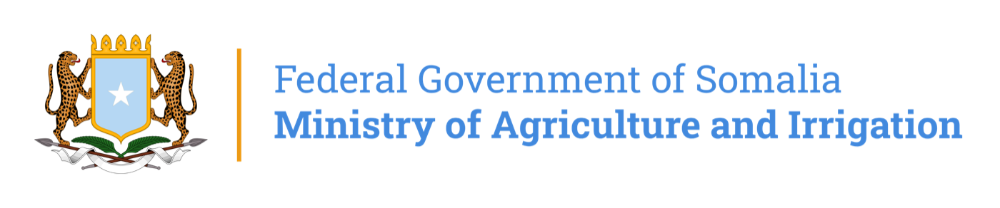

  

# Ministry of Agriculture and Irrigation

This is the official GitHub organization of the Ministry of Agriculture and Irrigation (MoAI), Federal Government of Somalia. It holds the source code for the Ministry's digital systems and the public services built on them.

## About

The Ministry leads Somalia's agricultural development, irrigation and food security. Its digital systems support farmers, value chains, market information and the Ministry's programmes across the Federal Member States.

## Access

All of the Ministry's code repositories are private. Access is managed by the Ministry's ICT section and is given only to Ministry staff and approved vendors.

## Contact

- Website: [moa.gov.so](https://moa.gov.so)
- ICT section: [ict@moa.gov.so](mailto:ict@moa.gov.so)

To report a security issue, please read our [security policy](https://github.com/MoAI-FGS/.github/blob/main/SECURITY.md). Do not open a public issue.
